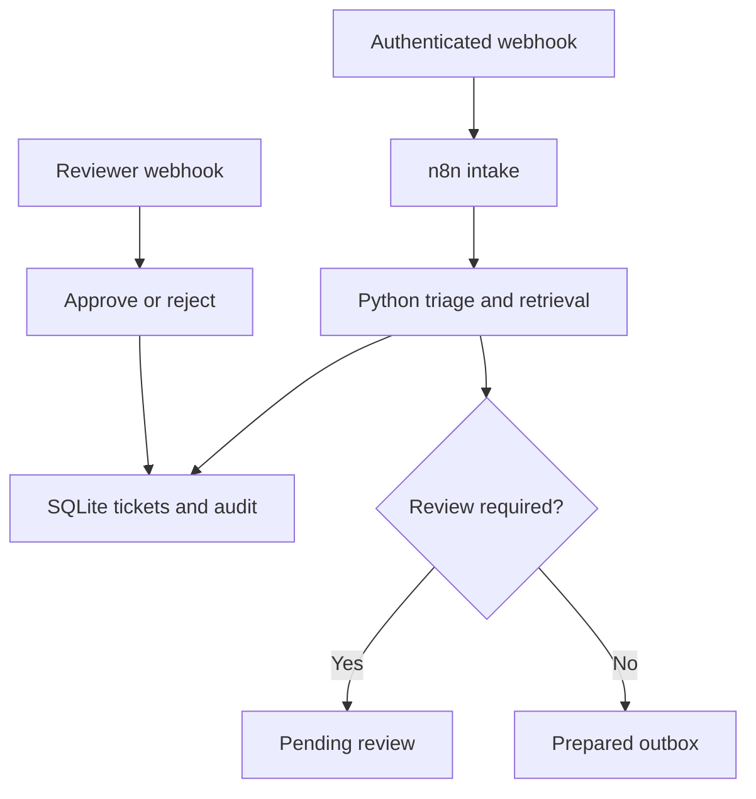

# ResolveFlow

**Support-ticket automation with n8n, Python, knowledge retrieval, and human approval.**

ResolveFlow categorizes support requests, retrieves relevant knowledge, prepares response drafts, and routes sensitive cases for review. Repeated webhook events reuse durable ticket records instead of creating duplicate work.

**Maintainer:** Hamza Iqbal Malik · **Status:** portfolio implementation, local deployment baseline

## Features

- Two importable n8n workflows: ticket intake/routing and approve/reject review.
- Python REST service with SQLite persistence and an application audit trail.
- Lexical knowledge retrieval with document IDs and transparent match scores.
- Deterministic demo mode; optional local Ollama generation.
- Separate intake/reviewer tokens; model failures route to review.
- Duplicate protection, conflicting event detection, transactional review transitions.
- Compose deployment, sample payloads, tests, and GitHub Actions checks.

## Architecture



The outbox is a durable ticket state, not an email delivery system. No customer messages are sent. Retrieval uses token overlap, not embeddings; match scores measure query coverage, not model confidence. Approval authorizes the draft state, not a refund or account action.

## Quick start

Requires Python 3.12+ for setup and Docker with Compose v2 for the full stack.

```bash
python scripts/setup.py
docker compose up --build -d
```

1. Open http://localhost:5678 and create your local n8n owner account.
2. Import both JSON files in `workflows/` using **Import from File**.
3. Create two n8n **Header Auth** credentials with header name `X-API-Key`. Copy `API_TOKEN` from `.env` into the intake credential and `REVIEWER_TOKEN` into the reviewer credential.
4. Assign the intake credential to **Ticket intake** and **Prepare ticket**. Assign the reviewer credential to **Reviewer action** and **Apply review**. Credential secrets and IDs are not bundled.
5. Publish/activate both workflows, then run:

```bash
python scripts/demo.py
```

Expect a VPN ticket, a duplicate replay, a billing ticket held for review, then approval. Test-listener URLs use `/webhook-test/` instead of `/webhook/`; the script targets published workflow URLs.

### Optional local AI

Change `AI_MODE=ollama` in `.env`, then:

```bash
docker compose --profile ai up -d
docker compose exec ollama ollama pull llama3.2:3b
docker compose up -d --force-recreate api
```

The selected model is configurable. Downloads, memory needs, and latency depend on your machine. Every model-written draft requires review. Demo mode returns curated knowledge text without invoking an LLM.

### Verify the Python service

No pip dependencies are required.

```bash
python -m unittest discover -s tests -v
python scripts/validate_workflows.py
```

For native service execution, export the generated `API_TOKEN` and `REVIEWER_TOKEN` into your shell and run `python -m service.app`. For native Ollama set `OLLAMA_URL=http://localhost:11434`. Workflow HTTP Request nodes use Docker hostname `api`; change it to a reachable host if running the API outside Compose.

## Files

| Path | Purpose |
| --- | --- |
| `workflows/` | Importable native n8n exports |
| `service/` | REST API, triage, retrieval, storage, review |
| `knowledge/` | Editable support knowledge |
| `examples/` | Ticket and review payloads |
| `tests/` | Behavioral and real HTTP API tests |
| `scripts/` | Setup, validation, demo |
| `docs/` | Research, decisions, walkthrough, validation |

## Tradeoffs and limits

SQLite reduces local setup. Transactions preserve one stored record/audit event per intake. Simultaneous duplicate requests can still perform redundant model calls before storage; a future claimed-job queue would avoid that wasted inference.

n8n orchestrates and branches; Python owns testable business logic. API errors stop the workflow. Retry transient failures with the same event ID. n8n's default error response does not necessarily relay API validation/conflict status codes verbatim.

No customer delivery connector, SLA scheduler, vector database, or distributed queue is implemented. Tokens identify roles, not individual reviewers. Audit records are application append-only, not tamper-proof. This is a local baseline: use HTTPS, a reverse proxy with request timeouts/concurrency limits, individual reviewer identities, and retention policies before external deployment. Image tags are configurable moving defaults; pin validated image digests for reproducibility.

## Portfolio description

Support-ticket automation combining n8n orchestration, a Python REST service, knowledge retrieval, local LLM drafting, duplicate protection, and audited human approval.

No customer deployment, measured savings, or performance claims are implied. See `docs/DEMO_GUIDE.md` for a walkthrough and resume wording after you run and review the project.

## License

Project-specific source and workflows are MIT licensed. The implementation was written independently after reviewing n8n's [self-hosted AI starter kit](https://github.com/n8n-io/self-hosted-ai-starter-kit). References and dependency licensing are recorded in `THIRD_PARTY_NOTICES.md`.
